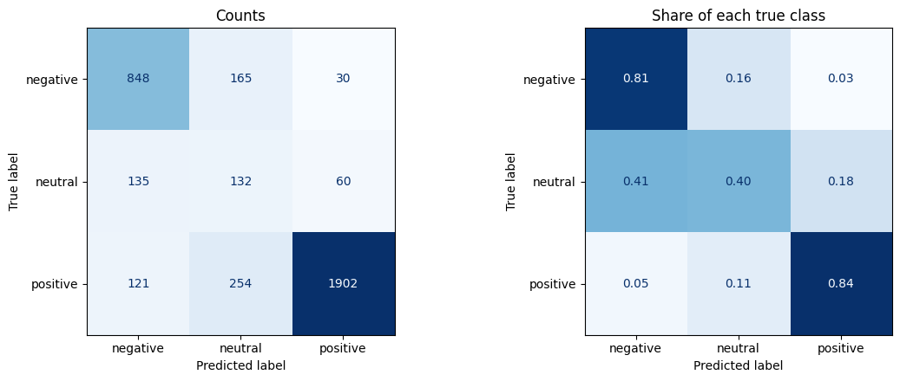
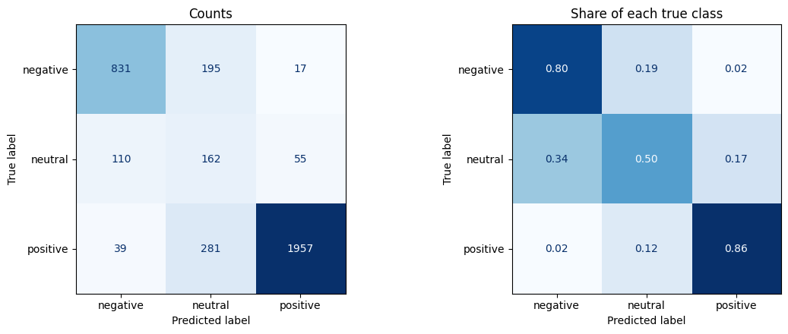

# Portuguese review sentiment: TF-IDF vs. fine-tuned BERTimbau

How much does a fine-tuned transformer buy over a classic baseline on Brazilian Portuguese reviews, and what does it cost?

**Answer:** about +3 points of macro-F1 for ~52x the CPU latency and ~270x the model size.

| | TF-IDF + LogReg | Fine-tuned BERTimbau |
|---|---|---|
| test macro-F1 | 0.661 | **0.689** |
| test accuracy | 0.790 | **0.809** |
| F1 neutral | 0.301 | **0.336** |
| latency, 1 review, CPU | **1.1 ms** | 59 ms |
| latency, 1 review, GPU (T4) | n/a | 10 ms |
| throughput, CPU | **39,200 reviews/s** | 17 reviews/s |
| training | 7 s, CPU | 5.2 min, T4 GPU |
| model size | **1.6 MB** | 436 MB |

Both models use the same train / validation / test split. Hyperparameters and the best epoch were picked on
validation; the test set was scored once. Three BERTimbau runs with the same code gave test macro-F1 0.689-0.693
(GPU training is not fully deterministic); the table shows the run whose weights are published.

## When to use which

- **TF-IDF** when volume is high, there is no GPU, or a ~1 ms response matters more than 3 points of F1.
  It is also fully interpretable: the top-weighted terms per class can be read directly.
- **BERTimbau** when quality matters most and a GPU is available (10 ms per review). It gains most on
  negative and neutral reviews, where wording like "bom, mas demorou" needs context.

## Findings

- **Neutral is the bottleneck for both models.** BERTimbau finds half of the neutral reviews (recall 0.50), but only
  25% of its neutral predictions are correct. Reading the errors shows many 3-star reviews whose text is clearly
  positive or negative: the star rating is a noisy label for the text, which caps the achievable score.
- **Deduplication matters.** 5,901 identical texts ("Muito bom", "Recomendo") were removed before splitting. Without
  this, the same text appears in train and test and inflates scores.
- **Macro-F1, not accuracy.** Always predicting "positive" already gives 62% accuracy but only 0.26 macro-F1.
- **Class weights helped both models.** `class_weight="balanced"` won the baseline grid search; the same weighting was used in BERTimbau's loss.

## Confusion matrices (test set)

TF-IDF + LogReg:



Fine-tuned BERTimbau:



## Project structure

| notebook | what it does |
|---|---|
| [`01_data_and_split`](notebooks/01_data_and_split.ipynb) ([Kaggle](https://www.kaggle.com/code/patrickjunmiyauraihy/olist-reviews-data-preparation-and-split)) | cleaning, deduplication, labels from stars, stratified 80/10/10 split |
| [`02_tfidf_baseline`](notebooks/02_tfidf_baseline.ipynb) ([Kaggle](https://www.kaggle.com/code/patrickjunmiyauraihy/olist-reviews-tf-idf-logistic-regression-bl)) | TF-IDF + logistic regression, 16-model grid on validation, error analysis, CPU cost |
| [`03_bertimbau_finetune`](notebooks/03_bertimbau_finetune.ipynb) ([Kaggle](https://www.kaggle.com/code/patrickjunmiyauraihy/olist-reviews-fine-tuning-bertimbau)) | BERTimbau fine-tuning on a T4, early stopping, CPU/GPU latency, comparison table |

Model on the Hugging Face Hub: [`patrickjunmiyauraihy/bertimbau-olist-sentiment`](https://huggingface.co/patrickjunmiyauraihy/bertimbau-olist-sentiment)

```python
from transformers import pipeline

clf = pipeline("text-classification", model="patrickjunmiyauraihy/bertimbau-olist-sentiment")
clf("Produto chegou antes do prazo, recomendo!")
```

## Reproduce

1. Run notebook 1 on Kaggle with the Olist dataset as input.
2. Run notebook 2 with notebook 1's output as input (CPU is enough).
3. Run notebook 3 with notebook 1's (and optionally notebook 2's) output as input, on a T4 GPU with Internet on.

Each notebook writes its metrics to JSON (see [`results/`](results/)), and the comparison table is built from those files.
The notebooks in this repository are the executed Kaggle versions, with outputs.

## Next

Phase 2: use an LLM to label complaint categories on negative reviews, check a hand-labelled gold set, and distill
into a small classifier, comparing quality, cost and latency against calling the LLM directly.

## Data and license

Olist, *Brazilian E-Commerce Public Dataset by Olist*, Kaggle, CC BY-NC-SA 4.0.
BERTimbau: Souza, Nogueira and Lotufo (2020), MIT license.
